<div align="center">

# Azure Capacity Service

**Azure subscription quota insights, delivered through a secure .NET API.**

An ASP.NET Core service for inspecting quota limits, current usage, and remaining quota across Azure subscriptions and regions.

<p>
  
  
  
  
</p>

<p>
  
  
</p>

<p>
  <a href="https://capacity-variksoft-dev-2026.azurewebsites.net/swagger"><strong>Explore Swagger UI</strong></a>
  &nbsp; · &nbsp;
  <a href="https://capacity-variksoft-dev-2026.azurewebsites.net/api/quotas"><strong>Try the API</strong></a>
  &nbsp; · &nbsp;
  <a href="https://capacity-variksoft-dev-2026.azurewebsites.net/openapi/v1.json"><strong>OpenAPI Specification</strong></a>
</p>

</div>

## 1. Overview

The service answers: **How much quota is available to this Azure subscription in a given region?**

The MVP supports:

- Reading quota limits and current usage from Azure Quota API.
- Calculating available quota.
- Listing quotas for a subscription and region.
- Finding a specific quota by name (case-insensitive).
- Using a configured default subscription and region, while allowing explicit overrides.
- Exposing JSON endpoints and interactive Swagger UI.

The API does not modify quotas, provision Azure resources, or guarantee regional capacity.

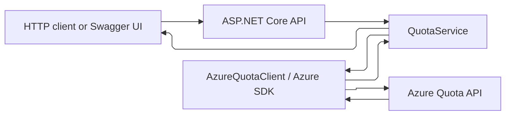

## 2. MVP Scope and Deployment Status

The application is a single ASP.NET Core Web API, without a custom graphical frontend. Swagger UI is available for interactive testing; a dedicated UI remains a future enhancement.

The current Azure deployment uses:

| Component | Current implementation |
| --- | --- |
| Runtime | .NET 10, ASP.NET Core Controllers |
| Hosting | Linux Azure App Service, Free F1 plan |
| Web App | `capacity-variksoft-dev-2026` |
| Resource group | `rg-azure-capacity-dev` |
| Infrastructure region | `swedencentral` |
| Quota resource provider | `Microsoft.Compute` |
| Authentication | `DefaultAzureCredential`; system-assigned managed identity in Azure |
| Infrastructure | Bicep at subscription and resource-group scopes |
| Delivery | GitHub Actions CI and CD using OIDC |
| Secret storage | Azure Key Vault with RBAC; integration prepared but not part of the quota request path |

Deployed application:

- API: `https://capacity-variksoft-dev-2026.azurewebsites.net/api/quotas`
- Swagger UI: `https://capacity-variksoft-dev-2026.azurewebsites.net/swagger`
- OpenAPI JSON: `https://capacity-variksoft-dev-2026.azurewebsites.net/openapi/v1.json`

The default quota endpoint has been exercised against the deployed application. This is a development deployment, not a claim of production readiness.

## 3. API Contract

All routes are read-only HTTP `GET` endpoints.

| Endpoint | Subscription | Region | Result |
| --- | --- | --- | --- |
| `GET /api/quotas` | Configured default | Configured default | All quotas |
| `GET /api/regions/{region}/quotas` | Configured default | Explicit | All quotas |
| `GET /api/subscriptions/{subscriptionId}/regions/{region}/quotas` | Explicit | Explicit | All quotas |
| `GET /api/subscriptions/{subscriptionId}/regions/{region}/quotas/{quotaName}` | Explicit | Explicit | Specific quota |

### Default subscription and region

```http
GET /api/quotas
```

Uses `Azure:SubscriptionId` and `Azure:DefaultRegion` from application configuration. The default region is currently `swedencentral`.

### Override only the region

```http
GET /api/regions/westeurope/quotas
```

Uses the configured subscription ID with the requested region.

### Override both subscription and region

```http
GET /api/subscriptions/{subscriptionId}/regions/westeurope/quotas
```

This is useful for testing another subscription, **provided the application's managed identity has permission on that subscription**. Supplying a subscription ID does not grant access.

### Retrieve one quota by name

```http
GET /api/subscriptions/{subscriptionId}/regions/westeurope/quotas/standardDSv5Family
```

The specific-quota route uses an explicit subscription and region. A short default-based route for an individual quota has **not** been implemented.

### HTTP responses

The quota-list routes may return `200`, `400`, `403`, `429`, or `502`, depending on validation and Azure API results. Missing default configuration can return `500`. The specific-quota route can also return `404` if the quota name is not found. Azure errors may also be mapped to `401` or `404` by the global handler. Unexpected failures are handled by ASP.NET Core's exception pipeline.

> **Security:** The current controllers do not enforce caller authentication or authorization. Azure RBAC protects Azure resources from the application's identity; it does **not** protect these public HTTP endpoints. Add API authentication, authorization, and appropriate restrictions before exposing this service for sensitive or multi-user use.

## 4. API Response

Illustrative response (not live quota data):

```json
{
  "subscriptionId": "<subscription-id>",
  "region": "westeurope",
  "quotas": [
    {
      "name": "standardDSv5Family",
      "displayName": "Standard DSv5 Family vCPUs",
      "limit": 20,
      "usage": 8,
      "available": 12,
      "unit": "Count"
    },
    {
      "name": "standardDv5Family",
      "displayName": "Standard Dv5 Family vCPUs",
      "limit": 10,
      "usage": 2,
      "available": 8,
      "unit": "Count"
    }
  ]
}
```

Available quota is computed in the response model:

```text
Available = Limit - Usage
```

Azure exposes quota limits and usage separately; the client matches them by quota name. Available quota is not a guarantee that a VM can be provisioned immediately.

## 5. Architecture

The application uses a layered design. Controllers handle HTTP, services handle application behavior, and the Azure client encapsulates SDK calls.

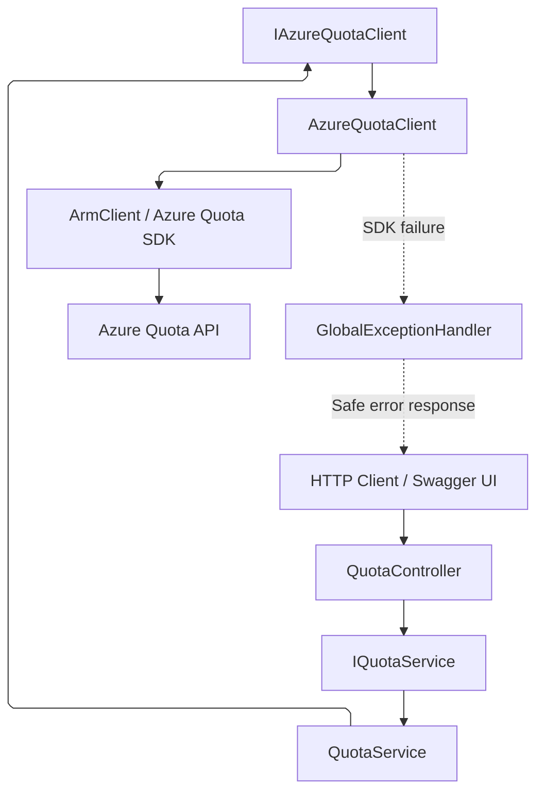

### QuotaController

- Receives requests, validates required route parameters, and returns HTTP responses.
- Resolves default subscription/region from `IOptions<AzureOptions>` for the short routes.
- Delegates quota retrieval to `IQuotaService`.
- Declares OpenAPI response metadata for the explicit routes.
- Does not contain Azure SDK-specific quota retrieval logic.

### QuotaService

- Delegates list retrieval to `IAzureQuotaClient`.
- Implements case-insensitive lookup of a quota by name.
- Keeps application logic separate from Azure SDK details.

### AzureQuotaClient

- Builds the ARM quota scope from subscription, provider, and region.
- Retrieves usage and quota-limit collections asynchronously.
- Matches usage to limits by quota name.
- Maps Azure SDK models to `QuotaInfo`.
- Wraps `RequestFailedException` as `AzureServiceException`.

### HttpClientFactory and SDK transport

`Program.cs` registers a named client:

```csharp
builder.Services.AddHttpClient("AzureSdk");
```

It passes an `HttpClientFactory`-created client to `ArmClient` via `HttpClientTransport`.

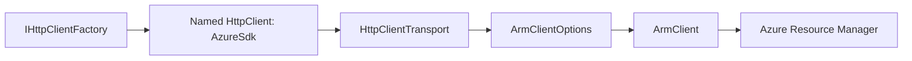

### Dependency injection

The API registers `IQuotaService` / `QuotaService`, `IAzureQuotaClient` / `AzureQuotaClient`, and `IKeyVaultService` / `KeyVaultService` as scoped services. `ArmClient` and `SecretClient` are registered as singletons. This separates callers from concrete implementations and enables unit testing with mocks.

### Async and cancellation

The `CancellationToken` is passed from the HTTP request through the service and Azure SDK calls. Cancellation is cooperative; it can stop work when the underlying operations honor the token.

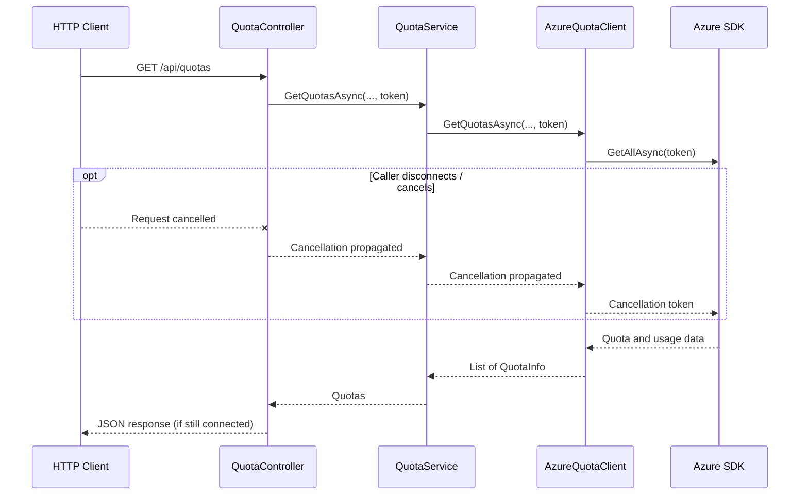

## 6. API Style: Controllers vs Minimal APIs

ASP.NET Core Controllers were selected over Minimal APIs. Both can implement the MVP, but Controllers provide explicit attribute routing, response metadata, constructor injection, and a convenient place to add authorization and validation later. HTTP concerns remain separate from the service and Azure SDK layers.

## 7. Azure Integration

The current provider is `Microsoft.Compute`. The quota scope has the following form:

```text
/subscriptions/{subscriptionId}/providers/Microsoft.Compute/locations/{region}
```

`AzureQuotaClient` reads the provider name from `AzureOptions`, rather than hardcoding it in the client. It uses `ArmClient.GetCurrentUsagesBases(scope)` and `ArmClient.GetCurrentQuotaLimitBases(scope)` to retrieve usage and limits.

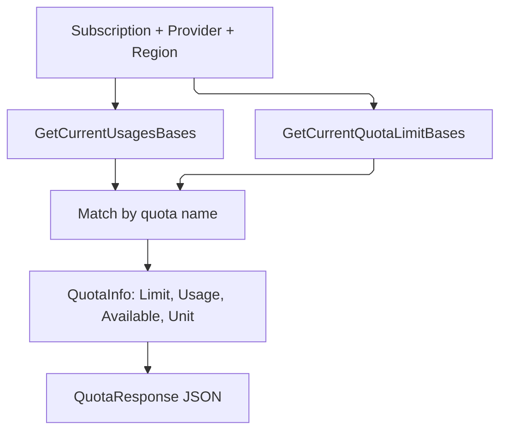

Regional quotas may differ between regions in the same subscription. The service reports quota availability, not physical hardware capacity.

## 8. Authentication and Azure RBAC

### Runtime authentication

The application currently uses:

```csharp
var credential = new DefaultAzureCredential();
```

For local development, the credential chain can use the developer's Azure CLI login (`az login`) or another supported development credential. In Azure App Service, it can use the Web App's **system-assigned managed identity**. No Azure client secret needs to be stored in source code.

### Separate deployment and runtime identities

The GitHub Actions deployment identity and the Web App runtime identity are **different principals** with different permissions.

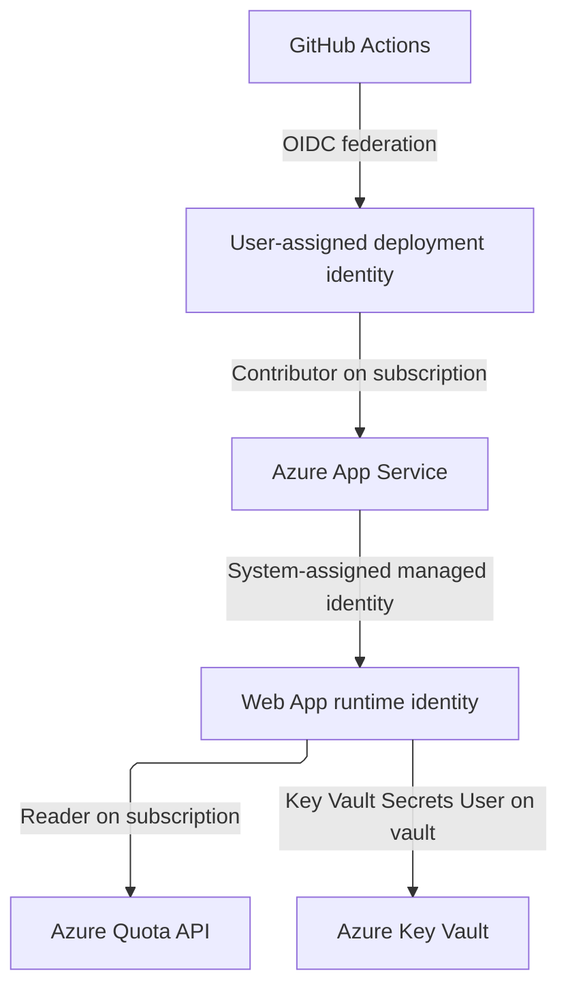

### Role assignments

| Principal | Role | Scope | Purpose |
| --- | --- | --- | --- |
| GitHub deployment managed identity | Contributor | Subscription | Publish application and manage supported Azure resources; cannot assign RBAC roles |
| Web App system-assigned managed identity | Reader | Subscription | Read subscription resources and supported quota data |
| Web App system-assigned managed identity | Key Vault Secrets User | Specific Key Vault | Read secret values from that vault |
| Human deployment account | Owner (used for initial infrastructure deployment) | Subscription | Bootstrap resources and RBAC assignments |

`roleAssignment.bicep` creates the subscription-level Reader assignment. `main.bicep` creates the Key Vault-scoped Secrets User assignment. The two assignments are separate because they apply to different scopes and permissions.

**RBAC is not authentication:** managed identity obtains a token, while RBAC determines which Azure operations that identity may perform. The application's ability to query a second subscription depends on its permissions in that subscription.

## 9. Azure Key Vault Integration

The Bicep deployment provisions an RBAC-enabled Azure Key Vault and grants the Web App identity the **Key Vault Secrets User** role. `KeyVault__VaultUri` configures its endpoint.

`Program.cs` registers `SecretClient` using the same `DefaultAzureCredential` used by `ArmClient`:

```csharp
builder.Services.AddSingleton<SecretClient>(sp =>
{
    var vaultUri = builder.Configuration["KeyVault:VaultUri"]
        ?? throw new InvalidOperationException("Key Vault URI is not configured.");

    return new SecretClient(new Uri(vaultUri), credential);
});
```

`KeyVaultService` implements `IKeyVaultService` and provides `VerifySecretAccessAsync(CancellationToken)`. It attempts to read a secret named `DeploymentVerificationSecret` and returns whether the retrieved value is non-null.

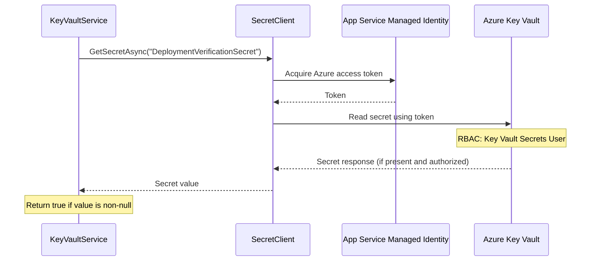

**Current limitation:** The Key Vault service is registered but is **not called by the quota endpoints**. The quota request path does not require a Key Vault secret. The existence of `DeploymentVerificationSecret` and successful runtime access to it have not been established by the code alone. Avoid exposing secret values through HTTP endpoints or logs.

Managed identity already authenticates to Azure Quota API without a stored secret. Key Vault is intended for credentials or other secrets needed by future integrations.

## 10. Data Models

### QuotaInfo

```csharp
public class QuotaInfo
{
    public required string Name { get; set; }
    public required string DisplayName { get; set; }
    public int Limit { get; set; }
    public int Usage { get; set; }
    public int Available => Limit - Usage;
    public required string Unit { get; set; }
}
```

### QuotaResponse

```csharp
public class QuotaResponse
{
    public required string SubscriptionId { get; set; }
    public required string Region { get; set; }
    public required IReadOnlyList<QuotaInfo> Quotas { get; set; }
}
```

### ErrorResponse

```csharp
public class ErrorResponse
{
    public required string Error { get; set; }
    public required string Message { get; set; }
}
```

The current model classes use `required` and `set` accessors. `Available` is computed rather than stored. No database is required for the read-only MVP.

## 11. Error Handling and Logging

`AzureQuotaClient` catches `RequestFailedException` and wraps it in `AzureServiceException`. `GlobalExceptionHandler` logs the original exception and maps Azure status codes:

| Azure error status | API status |
| --- | --- |
| 400 | 400 Bad Request |
| 401 | 401 Unauthorized |
| 403 | 403 Forbidden |
| 404 | 404 Not Found |
| 429 | 429 Too Many Requests |
| Other Azure SDK failures | 502 Bad Gateway |

The global handler returns a safe error body:

```json
{
  "error": "AzureServiceError",
  "message": "Azure service request failed."
}
```

The controller directly handles validation errors and a missing named quota. Missing default subscription or region configuration returns an HTTP 500 Problem Details response. The global handler logs the original exception, request path, Azure status, and final response status without returning the Azure exception message to the caller.

## 12. Configuration

The local `AzureCapacityService/appsettings.json` defines the resource provider:

```json
{
  "Azure": {
    "ResourceProvider": "Microsoft.Compute"
  }
}
```

In Azure, Bicep supplies the following App Settings:

| Azure App Setting | ASP.NET Core configuration key | Value source |
| --- | --- | --- |
| `Azure__ResourceProvider` | `Azure:ResourceProvider` | Bicep `resourceProvider` parameter (`Microsoft.Compute`) |
| `Azure__SubscriptionId` | `Azure:SubscriptionId` | `subscription().subscriptionId` |
| `Azure__DefaultRegion` | `Azure:DefaultRegion` | Bicep `location` parameter (`swedencentral`) |
| `KeyVault__VaultUri` | `KeyVault:VaultUri` | Deployed Key Vault URI |

ASP.NET Core maps double underscores in environment variable names to colons in configuration keys.

The current options class is:

```csharp
public class AzureOptions
{
    public required string ResourceProvider { get; init; }
    public string? SubscriptionId { get; init; }
    public string? DefaultRegion { get; init; }
}
```

It is registered via the Options Pattern:

```csharp
builder.Services.Configure<AzureOptions>(
    builder.Configuration.GetSection("Azure"));
```

The default subscription and region are optional for explicit routes but required for the short routes. When running locally, supply them through environment variables, user secrets, or a local configuration override if you want to call `/api/quotas`. They are configuration values, **not authentication credentials**. Do not commit actual secrets or tokens to the repository.

The default quota region currently matches the infrastructure deployment region; the Bicep template does not expose a separate default quota region parameter.

## 13. OpenAPI and Swagger UI

The application registers ASP.NET Core OpenAPI support:

```csharp
builder.Services.AddOpenApi();
app.MapOpenApi();
```

Swagger UI is configured to use the same OpenAPI document:

```csharp
app.UseSwaggerUI(options =>
{
    options.SwaggerEndpoint("/openapi/v1.json", "Azure Capacity Service v1");
});
```

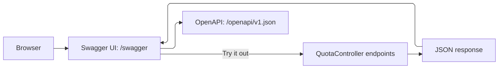

Local addresses depend on the launch profile and bound port; examples include `/swagger` and `/openapi/v1.json` on the local application host. The deployed URLs are listed in Section 2.

## 14. End-to-End Request Flow

For a default quota request:

```http
GET /api/quotas
```

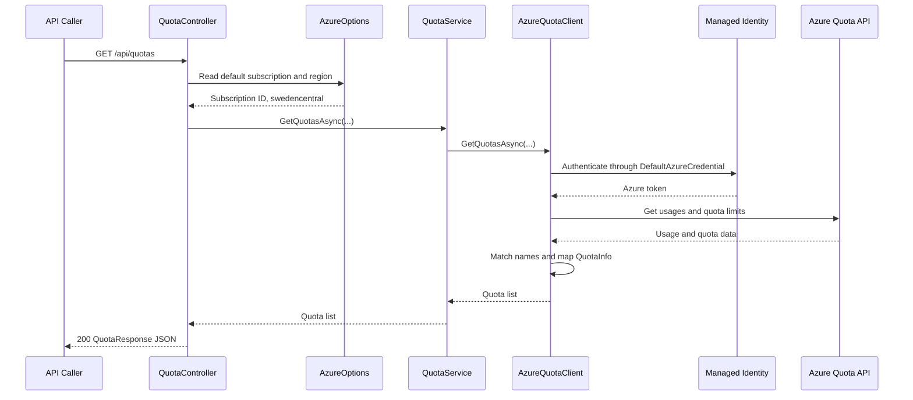

The actual Azure SDK token acquisition is handled internally and may be cached; the sequence illustrates the logical authentication and authorization path.

## 15. Project Structure

Relevant project files in the current repository:

```text
AzureCapacityService/
├── .github/
│   └── workflows/
│       ├── azure-auth.yml
│       ├── ci.yml
│       └── cd.yml
├── AzureCapacityService/
│   ├── Clients/
│   │   ├── IAzureQuotaClient.cs
│   │   └── AzureQuotaClient.cs
│   ├── Controllers/
│   │   └── QuotaController.cs
│   ├── Exceptions/
│   │   ├── AzureServiceException.cs
│   │   └── GlobalExceptionHandler.cs
│   ├── Models/
│   │   ├── ErrorResponse.cs
│   │   ├── QuotaInfo.cs
│   │   └── QuotaResponse.cs
│   ├── Options/
│   │   └── AzureOptions.cs
│   ├── Services/
│   │   ├── IKeyVaultService.cs
│   │   ├── KeyVaultService.cs
│   │   ├── IQuotaService.cs
│   │   └── QuotaService.cs
│   ├── iac/
│   │   ├── subscription.bicep
│   │   ├── main.bicep
│   │   └── roleAssignment.bicep
│   ├── AzureCapacityService.csproj
│   ├── Program.cs
│   └── appsettings.json
├── AzureCapacityService.Tests/
│   ├── Services/
│   │   └── QuotaServiceTests.cs
│   └── AzureCapacityService.Tests.csproj
├── docs/
│   ├── CSCP_DOMAIN.md
│   └── IaC.md
└── README.md
```

The MVP is a single API application, not a microservices system. The diagram and file tree describe the current structure without requiring a separate frontend or database.

## 16. Infrastructure as Code

The project uses Bicep to provision resources and permissions.

- `AzureCapacityService/iac/subscription.bicep` — **subscription scope**; creates the resource group, invokes the application module, and invokes the Reader-role module.
- `AzureCapacityService/iac/main.bicep` — **resource-group scope**; creates the Linux App Service Plan, Web App with system-assigned managed identity, Key Vault, App Settings, and vault-scoped role assignment.
- `AzureCapacityService/iac/roleAssignment.bicep` — **subscription scope**; assigns Reader to the Web App managed identity.

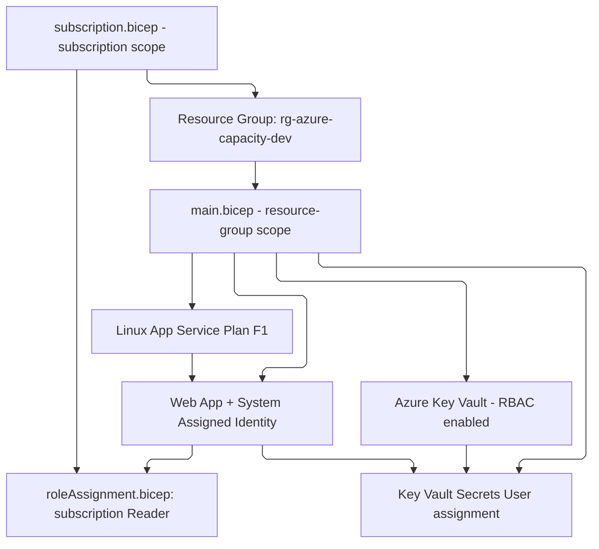

The subscription deployment can be validated locally:

```bash
az bicep build --file AzureCapacityService/iac/subscription.bicep
```

Preview changes:

```bash
az deployment sub what-if \
  --name capacity-infra-dev \
  --location swedencentral \
  --template-file AzureCapacityService/iac/subscription.bicep \
  --parameters appName="capacity-variksoft-dev-2026"
```

Apply infrastructure changes under an identity authorized to create RBAC assignments:

```bash
az deployment sub create \
  --name capacity-infra-dev \
  --location swedencentral \
  --template-file AzureCapacityService/iac/subscription.bicep \
  --parameters appName="capacity-variksoft-dev-2026"
```

These commands use Bash line continuations. For PowerShell, use backticks or place the command on one line.

Bicep was chosen because this is an Azure-only project with direct ARM integration and no requirement for multi-cloud state management.

## 17. GitHub Actions CI/CD

Application deployment is automated, but infrastructure deployment is currently a separate manual operation.

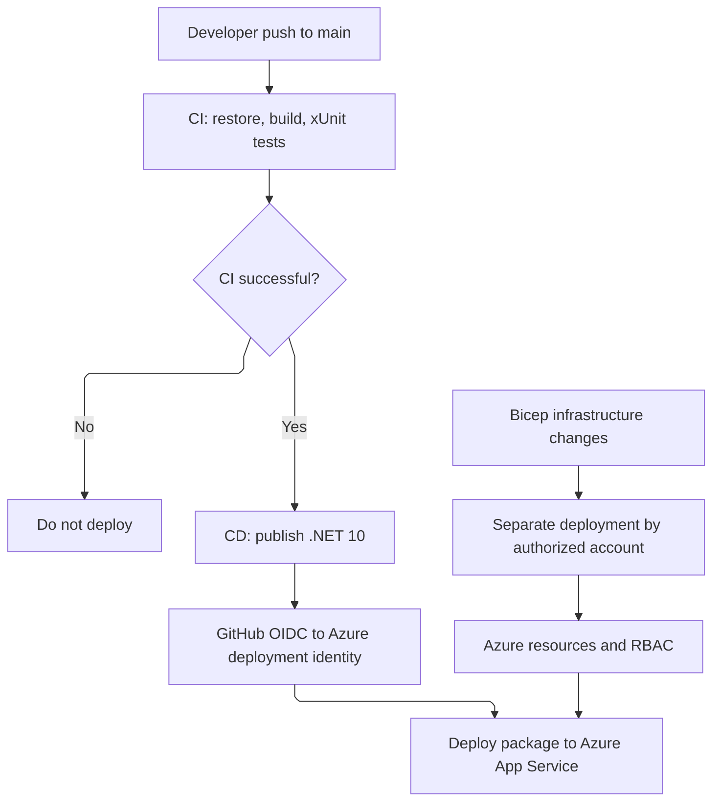

### CI: `.github/workflows/ci.yml`

- Runs on pushes to `main`, pull requests targeting `main`, and manual dispatch.
- Restores and builds the API and test project with .NET 10.
- Executes xUnit tests.

### CD: `.github/workflows/cd.yml`

- Runs after a successful CI workflow originating from a push to `main`, or by manual dispatch on `main`.
- Checks out the associated commit and publishes the .NET 10 application.
- Authenticates using `azure/login@v2` with OIDC.
- Deploys to App Service using `azure/webapps-deploy@v3`.

### OIDC: `.github/workflows/azure-auth.yml`

A separate manually triggered workflow verifies Azure login and resource-group access. Repository variables used for Azure login are `AZURE_CLIENT_ID`, `AZURE_TENANT_ID`, and `AZURE_SUBSCRIPTION_ID`.

These are **repository variables**, not authentication secrets. They identify the Azure client, tenant, and subscription; the workflow obtains its Azure token through OIDC. Variables can be used by workflows and are not appropriate for storing passwords, client secrets, or access tokens.

### What requires a manual infrastructure deployment?

| Change | Current deployment path |
| --- | --- |
| C# services, controllers, NuGet packages | Commit and push to `main` → CI/CD |
| Frontend code hosted with the app | CI/CD **only if** frontend build and packaging are configured |
| Bicep resources, RBAC, App Settings | Separate Bicep deployment |

The GitHub deployment identity has Contributor access but cannot create RBAC role assignments. For that reason, the current CD workflow deploys the **application package only** and does not run the Bicep deployment.

## 18. Testing and Verification

Unit tests use xUnit and Moq. The existing `QuotaServiceTests` verify:

- Case-insensitive lookup by quota name.
- Returning `null` for a missing quota.
- Returning a specific quota with expected limit, usage, and computed available value.
- Returning the list received from the mocked Azure client.

`IAzureQuotaClient` is mocked, so unit tests do not call Azure directly.

Run tests from the repository root:

```bash
dotnet test AzureCapacityService.Tests/AzureCapacityService.Tests.csproj
```

Manual integration verification has included deploying the API, checking App Settings, and receiving a response from the deployed `/api/quotas` endpoint. These checks do **not** establish automated integration-test coverage, Key Vault secret-read success, or authorization of public API callers.

## 19. Future Extensions

### API security

Add caller authentication and authorization, restrict cross-subscription queries as appropriate, and consider rate limiting before production or multi-tenant use.

### Quota modification

Support quota increase requests as a separate feature with appropriate validation and stronger permissions.

### Additional Azure SDK operations and resource providers

Explore other supported operations and providers such as `Microsoft.Network` or `Microsoft.MachineLearningServices` after confirming their quota API behavior.

### User interface

Build a dashboard for selecting subscription, region, and quota, and displaying utilization. The current repository does not contain a dedicated UI or frontend build pipeline.

### Monitoring and alerts

Add utilization thresholds, metrics, and alert delivery:

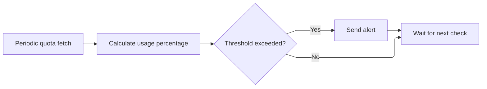

This diagram describes a **proposed** feature, not an existing background worker.

### Caching and background processing

Cache quota data briefly to reduce API calls. A background worker could periodically refresh data, calculate usage percentages and near-limit status, and record the last update time.

### Key Vault verification

Create a non-sensitive test secret and verify secret-read permissions through a controlled test that does not return the secret value. The service method exists, but it is not wired into an API endpoint or automated test.

### Infrastructure automation

Consider a separate, least-privilege IaC deployment workflow with appropriately scoped role-assignment permissions rather than expanding the application deployment identity's access unnecessarily.

## 20. MVP Summary

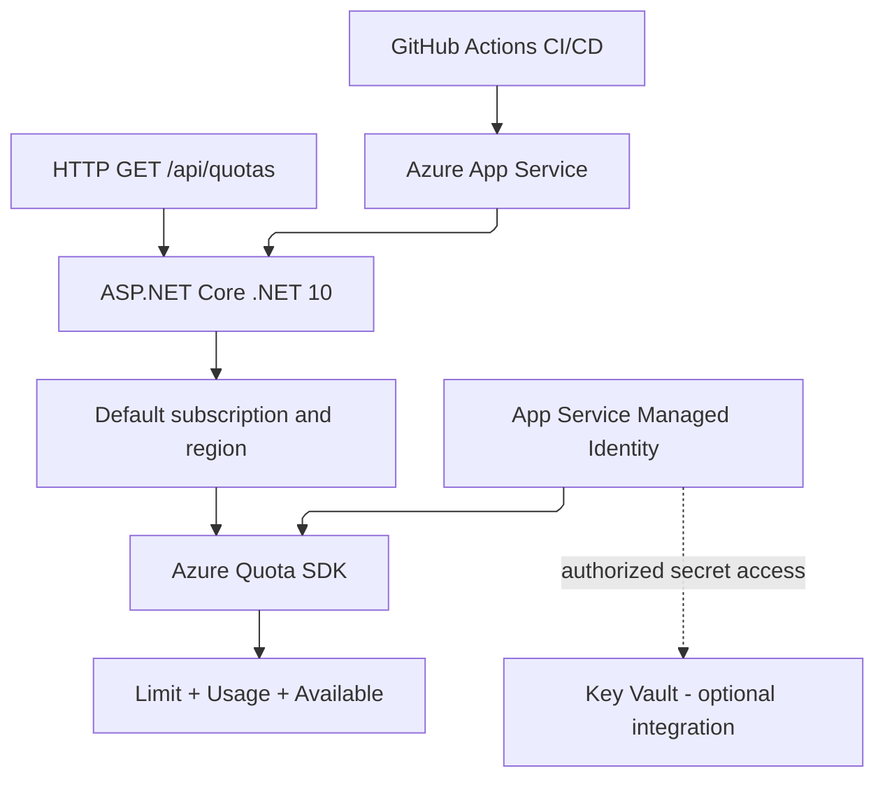

Implemented: Controllers, dependency injection, asynchronous quota retrieval, cancellation-token propagation, Azure SDK, computed available quota, centralized Azure error handling, logging, configuration via Options Pattern, default subscription and region, OpenAPI/Swagger UI, xUnit/Moq unit tests, Bicep infrastructure, managed identity/RBAC, Key Vault client/service registration, and GitHub Actions CI/CD.

Not yet implemented: custom UI, API caller authentication, quota modification, monitoring, caching, background refresh, automated real-Azure integration tests, and a wired Key Vault verification flow.

<div align="center">

**Azure Capacity Service** · ASP.NET Core · Azure SDK · Managed Identity · Bicep · GitHub Actions

[CSCP Domain Notes](docs/CSCP_DOMAIN.md) &nbsp; · &nbsp; [Infrastructure Documentation](docs/IaC.md)

<sub>Development MVP</sub>

</div>
