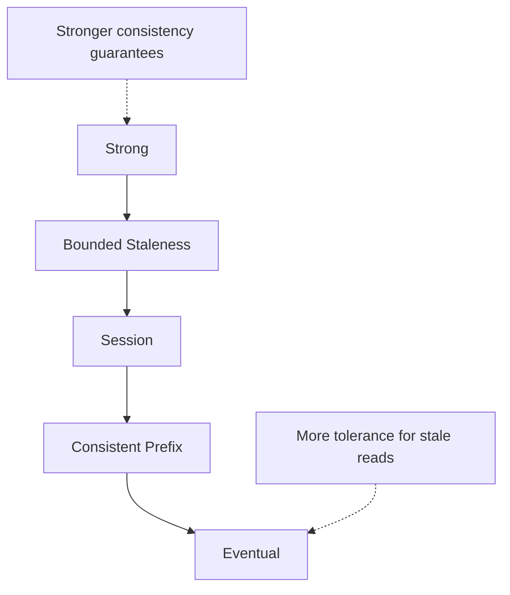
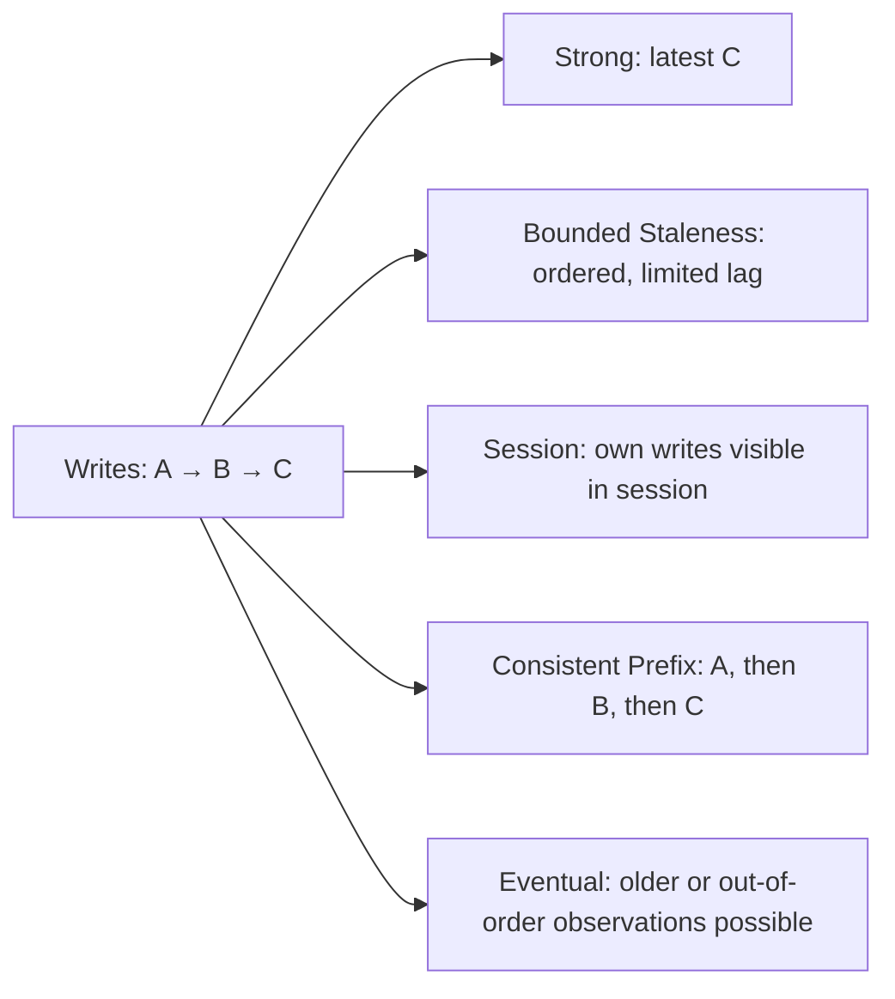

# Azure Cosmos DB Consistency Levels

## Overview

Azure Cosmos DB can replicate data across multiple replicas and regions. When an application writes data, different replicas may not all reflect the update at exactly the same moment.

A **consistency level** determines what an application is guaranteed to observe when reading replicated data. Azure Cosmos DB provides five consistency levels, from stronger freshness guarantees to greater tolerance for temporarily stale reads.

## 1. Strong consistency

**Strong consistency** guarantees that a read returns the latest committed version of the data. Once a write has completed, subsequent reads do not return an older committed version.

**Example:** An application updates a critical configuration value. Every subsequent reader must see the updated configuration rather than an older value.

**When it is useful:** When stale reads are unacceptable and all readers need a single up-to-date view.

**Consideration:** Strong consistency imposes stricter latency and availability trade-offs, and it is not supported by every multi-region configuration. It does not replace transactions or concurrency control.

## 2. Bounded Staleness consistency

**Bounded Staleness** allows reads to lag behind recent writes, but only within a configured limit. The limit is expressed in terms of a maximum number of versions (**K**) or a time interval (**T**). Reads preserve write order.

**Example:** An analytics dashboard can display inventory information that is slightly behind the latest updates, as long as the delay stays within an agreed bound.

**When it is useful:** When the application can accept some delay but needs a predictable upper bound on how stale data may be.

## 3. Session consistency

**Session consistency** provides guarantees within a client session, including **read-your-writes** and **monotonic reads**. A user can see their own completed updates, even while other sessions may temporarily see older data.

**Example:** A customer adds an item to a shopping cart. Refreshing the cart in the same session shows the added item immediately.

**When it is useful:** For user-facing applications such as shopping carts, profiles, and dashboards where each user needs a consistent personal experience.

Session consistency is the default for Azure Cosmos DB for NoSQL accounts. Session tokens help preserve the guarantee when requests pass between application instances or clients.

## 4. Consistent Prefix consistency

**Consistent Prefix** guarantees that readers observe writes in their original order, although they may not yet see the latest writes. It does not set a maximum delay.

**Example:** An order status changes in this order:

1. Order placed
2. Order packed
3. Order shipped

A reader may temporarily see only the first two events, but should not observe the shipping event before the earlier events in that ordered history.

**When it is useful:** For ordered event feeds or activity histories where sequence matters more than immediate freshness.

## 5. Eventual consistency

**Eventual consistency** allows replicas to return older values temporarily. If updates stop, the replicas eventually converge to the same state. There is no fixed staleness bound or ordering guarantee for reads.

**Example:** A product's like count might briefly show 1,250 in one region and 1,248 in another. The temporary difference is acceptable.

**When it is useful:** For noncritical counters, statistics, and other data where temporarily stale reads are acceptable.

## Comparison

| Consistency level | Latest committed data? | Bounded lag? | Ordering guarantee? | Example |
|---|---|---|---|---|
| **Strong** | Yes | No lag after a committed write | Yes | Critical configuration |
| **Bounded Staleness** | Not always | Yes | Yes | Inventory analytics |
| **Session** | For own writes within the session | Not globally | Within the session | Shopping cart |
| **Consistent Prefix** | Not always | No | Yes | Order event history |
| **Eventual** | Not always | No | No | Like counters |

## Example of replica visibility

Suppose an application writes three updates in order: `A`, then `B`, then `C`.

This diagram illustrates read guarantees conceptually; it does not mean that one database query returns the complete sequence of updates.

## Additional considerations

- The appropriate level depends on the application's requirements for freshness, ordering, latency, and availability.
- A request may be able to use a weaker consistency level than the account default, depending on the API and SDK, but not a stronger one than the account allows.
- Consistency settings do not replace optimistic concurrency, transactions, or conflict resolution.
- Performance and regional availability trade-offs depend on the replication topology and configuration.

## References

- [Azure Cosmos DB consistency levels](https://learn.microsoft.com/en-us/azure/cosmos-db/consistency-levels)
- [Manage consistency levels](https://learn.microsoft.com/en-us/azure/cosmos-db/how-to-manage-consistency)
