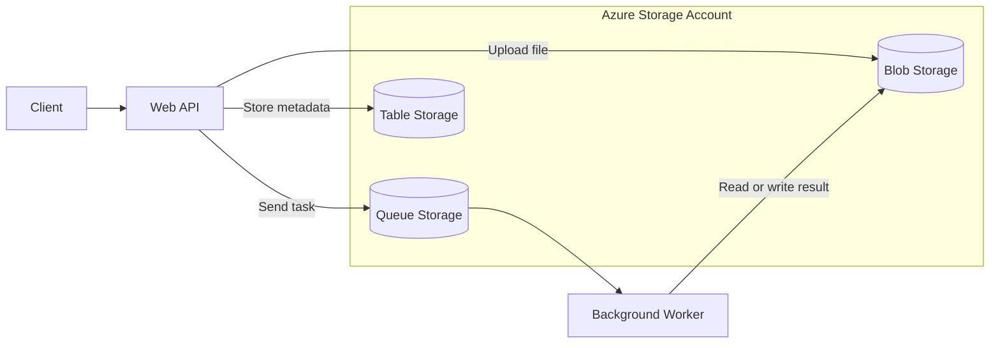
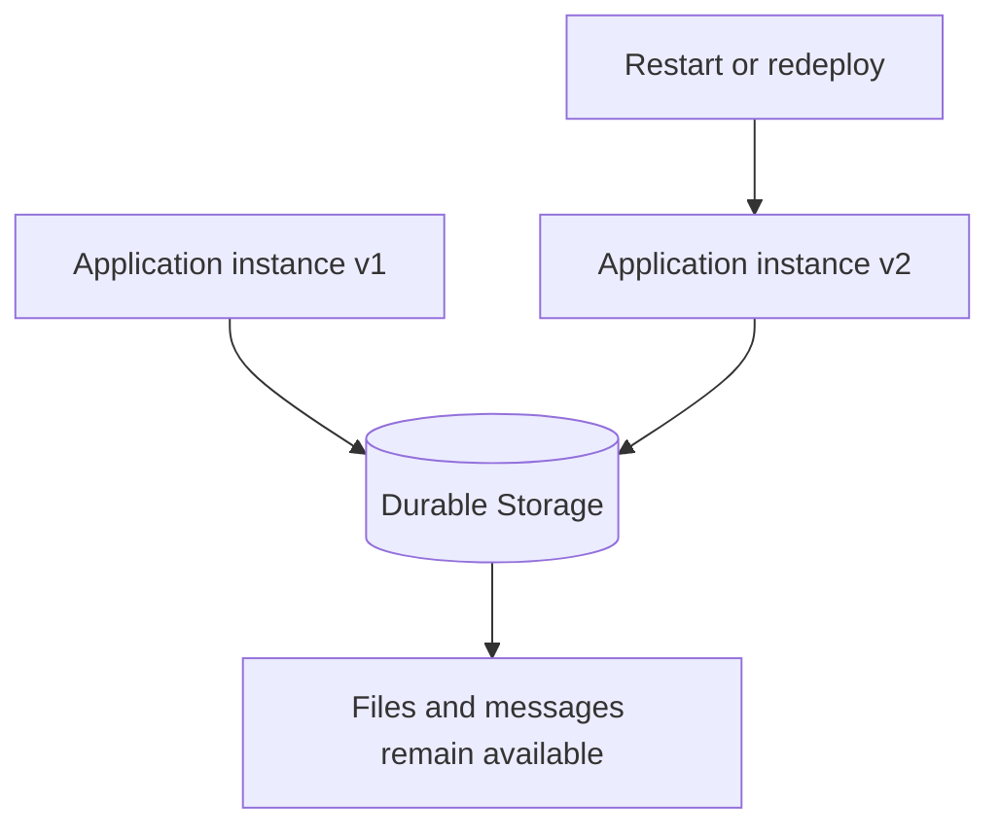

# Azure Storage Account: A Core Building Block of Azure

## Overview

An **Azure Storage Account** provides a place to store and manage data in Azure. It groups storage services under a common namespace and configuration for security, networking, and redundancy.

Cloud applications need storage because application instances are temporary: a virtual machine may be restarted, a container replaced, or a web app redeployed. Data often needs to remain available independently of those changes.

## Storage services

| Service | Purpose | Example |
|---|---|---|
| **Blob Storage** | Stores unstructured objects such as documents, images, and backups | A website stores uploaded profile pictures |
| **Azure Files** | Provides managed file shares over SMB or NFS | Multiple servers access shared files |
| **Queue Storage** | Stores messages for asynchronous processing | An API sends jobs to a background worker |
| **Table Storage** | Stores simple NoSQL entities | An application stores metadata or lookup records |
| **Data Lake Storage Gen2** | Adds analytics-oriented capabilities to Blob Storage | A data pipeline organizes large datasets |

Data Lake Storage Gen2 is based on Blob Storage with hierarchical namespace enabled; it is not a separate storage service.

## How storage fits into an application

In this example, the API receives a file and saves it to Blob Storage. It places a processing request in Queue Storage. A background worker processes the request and stores the result. The API and worker can restart without losing the stored files or queued messages.

## Why it is foundational

### Data persists independently of compute

Compute resources run application code, while storage holds data that must survive application restarts, scaling, and redeployments. Separating these responsibilities makes applications easier to maintain and recover.

### Applications can share data

Multiple web app instances, virtual machines, and background workers can access the same storage services. This supports distributed applications and horizontal scaling.

### Storage enables asynchronous communication

Queue Storage allows one component to submit work without waiting for another component to finish it immediately. This helps absorb bursts of traffic and separates services from one another.

### Azure provides durability and redundancy options

Azure Storage can keep multiple copies of data, depending on the chosen redundancy configuration:

| Option | Description |
|---|---|
| **LRS** | Copies data within a single datacenter in the primary region |
| **ZRS** | Copies data across availability zones in the primary region |
| **GRS / RA-GRS** | Replicates data to a secondary region; RA-GRS permits reads from the secondary |
| **GZRS / RA-GZRS** | Combines zone redundancy in the primary region with replication to a secondary region |

Geo-replication is asynchronous, so regional failover may involve some data loss. The available options depend on account type and region.

### Security and access can be controlled centrally

Storage accounts support encryption at rest, network restrictions, private endpoints, and access management using Microsoft Entra ID and Azure RBAC. Applications can use managed identities instead of storing credentials in source code.

### Capacity and cost can be managed separately

Storage capacity can grow independently of application compute. Blob access tiers and lifecycle policies can also help manage the cost of frequently accessed and older data.

## Separation of storage and compute

**Important distinction:** Azure Managed Disks use Azure's storage infrastructure, but modern managed disks are not stored as resources inside a customer-created Storage Account. Not every Azure service requires you to create a Storage Account explicitly.

## References

- [Azure Storage account overview](https://learn.microsoft.com/en-us/azure/storage/common/storage-account-overview)
- [Azure Storage redundancy](https://learn.microsoft.com/en-us/azure/storage/common/storage-redundancy)
- [Azure Storage security](https://learn.microsoft.com/en-us/azure/storage/common/storage-security-guide)
