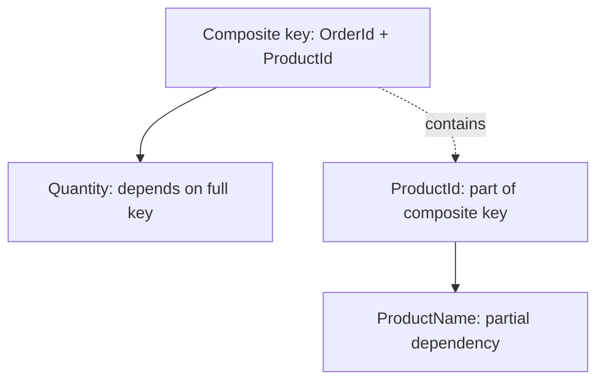
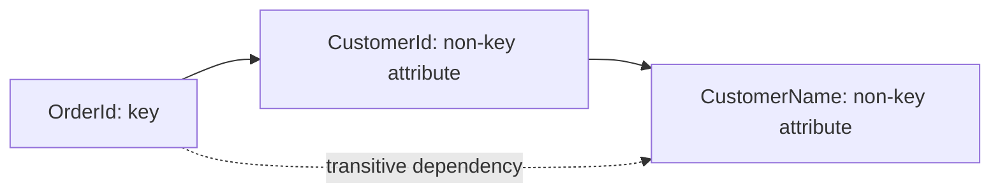

# Partial and Transitive Dependencies in SQL and C#

## Overview

**Partial dependency** and **transitive dependency** are concepts from relational database design. They describe how columns depend on keys and help identify data redundancy and update anomalies.

They are not formal language features of C#. However, a C# application can model the same relationships through entities, object references, and data-access code. The term *transitive dependency* also has a separate meaning in software architecture and dependency injection.

## Functional dependencies

A functional dependency `A → B` means that each value of `A` determines exactly one value of `B` within the data model. For example, if each product has one current name, then:

```text
ProductId → ProductName
```

A **composite key** is a key formed from two or more columns, such as `(OrderId, ProductId)`.

## Partial dependency

A partial dependency occurs when a non-key attribute depends on **only part of a candidate key**, rather than on the entire key. It is especially relevant when the key contains multiple columns.

Consider this table:

| OrderId | ProductId | ProductName | Quantity |
|---|---|---|---|
| 101 | 10 | Keyboard | 2 |
| 101 | 20 | Mouse | 1 |
| 102 | 10 | Keyboard | 1 |

Assume `(OrderId, ProductId)` is the composite primary key.

- `(OrderId, ProductId) → Quantity`: the quantity belongs to a particular order line.
- `ProductId → ProductName`: the product name depends only on one part of the composite key.

Therefore, `ProductName` is partially dependent on the composite key. Repeating it across order lines creates redundancy. This is the type of dependency addressed by **Second Normal Form (2NF)**.



A normalized design separates products from order lines:

```sql
CREATE TABLE Products (
    ProductId INT PRIMARY KEY,
    ProductName NVARCHAR(100) NOT NULL
);

CREATE TABLE OrderItems (
    OrderId INT NOT NULL,
    ProductId INT NOT NULL,
    Quantity INT NOT NULL,
    PRIMARY KEY (OrderId, ProductId),
    FOREIGN KEY (ProductId) REFERENCES Products(ProductId)
);
```

Now each product name is stored once.

## Transitive dependency

A transitive dependency occurs when a non-key attribute depends on a key **through another non-key attribute**.

For example, consider an `Orders` table:

| OrderId | CustomerId | CustomerName |
|---|---|---|
| 101 | 7 | Anna |
| 102 | 7 | Anna |
| 103 | 9 | Mark |

Assuming each order belongs to one customer and each customer ID identifies one name:

```text
OrderId → CustomerId
CustomerId → CustomerName
Therefore: OrderId → CustomerName (transitively)
```

`CustomerName` is determined by `OrderId` indirectly, through `CustomerId`. Storing the name in every order risks inconsistent updates. This is the type of dependency addressed by **Third Normal Form (3NF)**, subject to the formal conditions of 3NF.



A normalized design stores customer details separately:

```sql
CREATE TABLE Customers (
    CustomerId INT PRIMARY KEY,
    CustomerName NVARCHAR(100) NOT NULL
);

CREATE TABLE Orders (
    OrderId INT PRIMARY KEY,
    CustomerId INT NOT NULL,
    FOREIGN KEY (CustomerId) REFERENCES Customers(CustomerId)
);
```

Customer names are then retrieved with a join:

```sql
SELECT o.OrderId, c.CustomerName
FROM Orders AS o
JOIN Customers AS c ON c.CustomerId = o.CustomerId;
```

## How this relates to C#

C# does not enforce database normal forms. It typically represents normalized relationships with entities and navigation properties. For example:

```csharp
public sealed class Customer
{
    public int Id { get; set; }
    public string Name { get; set; } = string.Empty;
}

public sealed class Order
{
    public int Id { get; set; }
    public int CustomerId { get; set; }
    public Customer Customer { get; set; } = null!;
}

public sealed class Product
{
    public int Id { get; set; }
    public string Name { get; set; } = string.Empty;
}

public sealed class OrderItem
{
    public int OrderId { get; set; }
    public int ProductId { get; set; }
    public int Quantity { get; set; }
    public Product Product { get; set; } = null!;
}
```

These classes illustrate how an ORM such as Entity Framework Core can represent separate tables and their relationships. Actual EF Core key and relationship configuration may also be needed, especially for the composite key on `OrderItem`.

In **dependency injection**, the phrase *transitive dependency* means something different: if `OrderService` depends on `CustomerService`, and `CustomerService` depends on `DbContext`, then `DbContext` is a transitive software dependency of `OrderService`. This is a dependency graph, not a database functional dependency.


## Comparison

| Aspect | Partial dependency | Transitive dependency |
|---|---|---|
| Definition | Non-key attribute depends on a proper subset of a candidate key | Non-key attribute depends on a key through another non-key attribute |
| Typical example | `ProductId → ProductName` when key is `(OrderId, ProductId)` | `OrderId → CustomerId → CustomerName` |
| Normalization | Addressed by 2NF | Addressed by 3NF |
| Typical problem | Repeated product information in order lines | Repeated customer information in orders |

**Summary:** Partial and transitive dependencies are properties of relational data models. C# can represent the normalized model, but these terms should not be confused with class dependencies or dependency injection.
