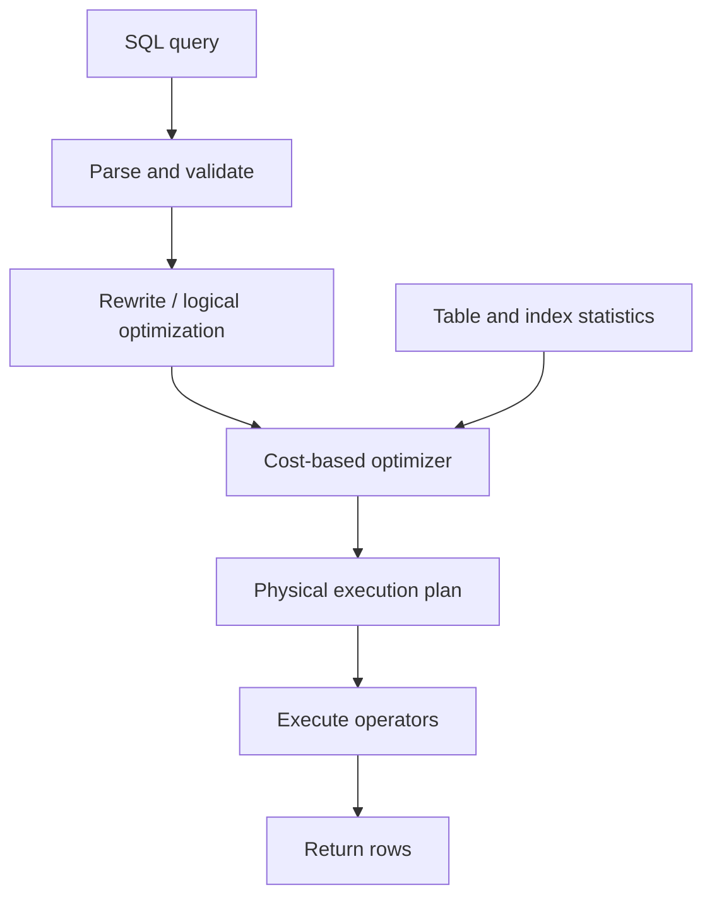
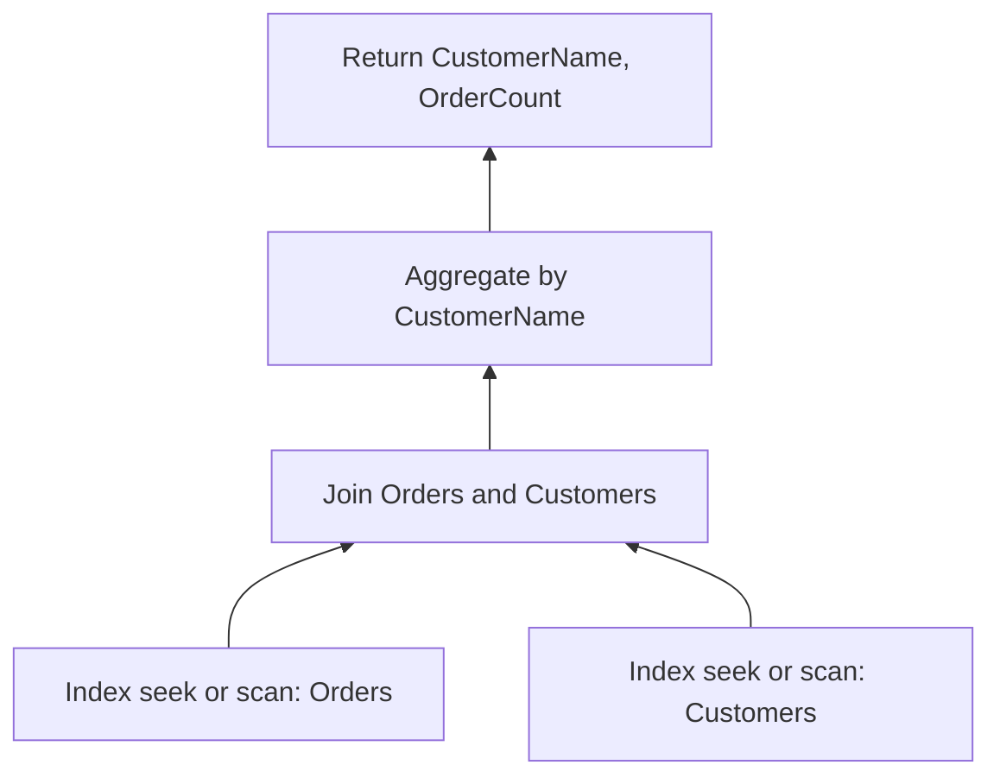
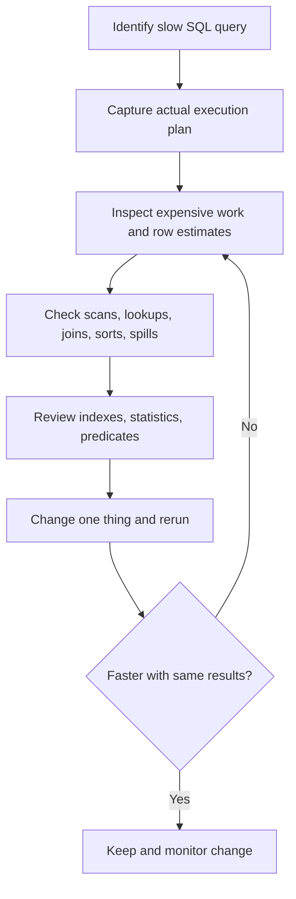

# Query Execution Plans in SQL

## Overview

A **query execution plan** describes how a database engine intends to execute, or actually executed, a SQL statement. The query specifies *what* data is needed; the plan describes *how* the database obtains it.

A database optimizer evaluates possible access paths and operations, such as reading a table, using an index, joining rows, sorting, and aggregating. It chooses a plan using available statistics and an internal cost model. The chosen plan is not guaranteed to be the fastest possible plan in every runtime situation.

## How a query becomes an execution plan



The exact processing stages differ by database engine, but the general principle is similar.

## Common plan operators

| Operator | What it does | Typical consideration |
|---|---|---|
| Table / clustered index scan | Reads many or all rows from a table or index | Can be efficient when a large portion of the data is needed |
| Index seek | Navigates an index to find a qualifying range | Often useful for selective predicates |
| Key lookup | Retrieves columns not available in a nonclustered index | Many repeated lookups can become expensive |
| Nested loops join | Repeatedly matches rows from one input against another | Often effective when one input is small and the other is indexed |
| Hash join | Builds a hash table from one input and probes it with another | Often useful for large, unsorted inputs; needs memory |
| Merge join | Combines ordered inputs | Efficient when both inputs are already suitably ordered |
| Sort | Orders rows | May use substantial memory or spill to disk |
| Aggregate | Computes values such as `COUNT`, `SUM`, or grouped results | Can use stream or hash-based processing |

An index seek is **not always better** than a scan. Reading most of a small table sequentially can be cheaper than many individual index lookups.

## Example query and plan

Suppose the database contains `Orders` and `Customers`:

```sql
SELECT c.CustomerName, COUNT(*) AS OrderCount
FROM Orders AS o
JOIN Customers AS c ON c.CustomerId = o.CustomerId
WHERE o.OrderDate >= '2026-01-01'
GROUP BY c.CustomerName;
```

One *possible* physical plan is:



This diagram is illustrative, not the actual plan for the query. The real plan depends on indexes, data distribution, statistics, parameter values, and the database engine.

## Estimated vs. actual plans

An **estimated execution plan** shows the optimizer's intended operations and estimated row counts without executing the query.

An **actual execution plan** includes runtime information from a completed execution, such as actual rows processed and, depending on the engine, timing, reads, or memory-related details.

A large difference between **estimated rows** and **actual rows** may indicate inaccurate statistics, skewed data, or a predicate the optimizer struggles to estimate. This can cause poor join choices or inappropriate memory grants.

## Viewing execution plans

### SQL Server

In SQL Server Management Studio (SSMS), use **Display Estimated Execution Plan** or **Include Actual Execution Plan** before running the query.

SQL Server also supports these commands:

```sql
-- Estimated plan; the query is not executed.
SET SHOWPLAN_XML ON;
GO
SELECT * FROM Orders WHERE CustomerId = 7;
GO
SET SHOWPLAN_XML OFF;
GO
```

For runtime I/O and timing diagnostics:

```sql
SET STATISTICS IO ON;
SET STATISTICS TIME ON;

SELECT * FROM Orders WHERE CustomerId = 7;

SET STATISTICS IO OFF;
SET STATISTICS TIME OFF;
```

`STATISTICS IO` reports logical reads, which are often useful when comparing query changes. The graphical actual plan can show operator-level runtime metrics.

### PostgreSQL

```sql
-- Estimates only; does not execute the statement.
EXPLAIN
SELECT * FROM orders WHERE customer_id = 7;

-- Executes the statement and reports runtime details.
EXPLAIN (ANALYZE, BUFFERS)
SELECT * FROM orders WHERE customer_id = 7;
```

**Caution:** `EXPLAIN ANALYZE` executes the SQL statement. For `UPDATE`, `DELETE`, or `INSERT`, it can modify data unless run in a transaction that is rolled back.

## Example: making a predicate index-friendly

Consider an indexed `OrderDate` column in SQL Server.

A predicate applying a function to the column can make efficient index access more difficult:

```sql
-- Often harder to optimize with a normal index on OrderDate.
SELECT *
FROM Orders
WHERE YEAR(OrderDate) = 2026;
```

A range predicate is usually more index-friendly (*SARGable*):

```sql
SELECT *
FROM Orders
WHERE OrderDate >= '2026-01-01'
  AND OrderDate < '2027-01-01';
```

A supporting index might be:

```sql
CREATE INDEX IX_Orders_OrderDate ON Orders(OrderDate);
```

Whether this improves performance depends on the table size, selectivity, and columns requested. Adding indexes also increases storage and write-maintenance costs.

## A practical plan-analysis workflow



Focus on **actual elapsed time, CPU time, logical reads, and row counts** rather than relying only on graphical cost percentages. Operator cost percentages are optimizer estimates, not measured percentages of elapsed time.

## Common causes of inefficient plans

- Missing or poorly aligned indexes.
- Stale or unrepresentative statistics.
- Non-SARGable filters and implicit type conversions.
- Large differences between estimated and actual row counts.
- Excessive key lookups, unnecessary sorts, or memory spills.
- Plan reuse that performs poorly for different parameter values (often discussed as *parameter sniffing* in SQL Server).

**Summary:** An execution plan is the primary tool for understanding how SQL is processed. Compare estimated behavior with actual runtime metrics, identify the bottleneck, and measure the effect of each optimization.
